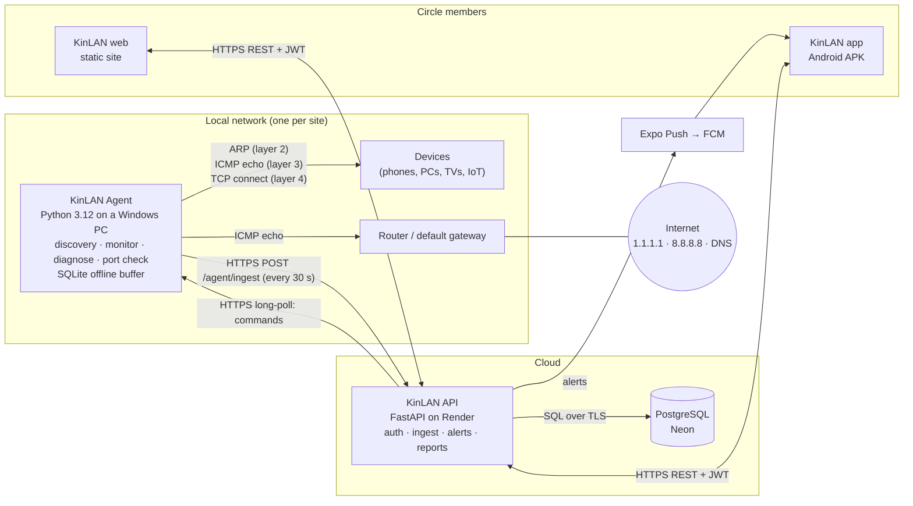
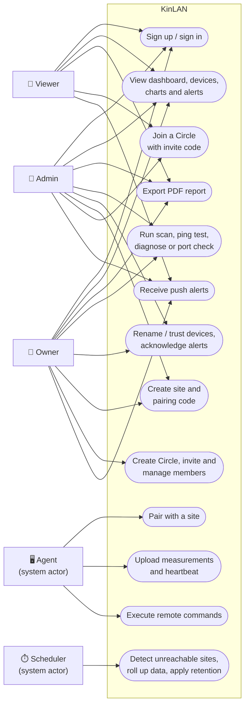
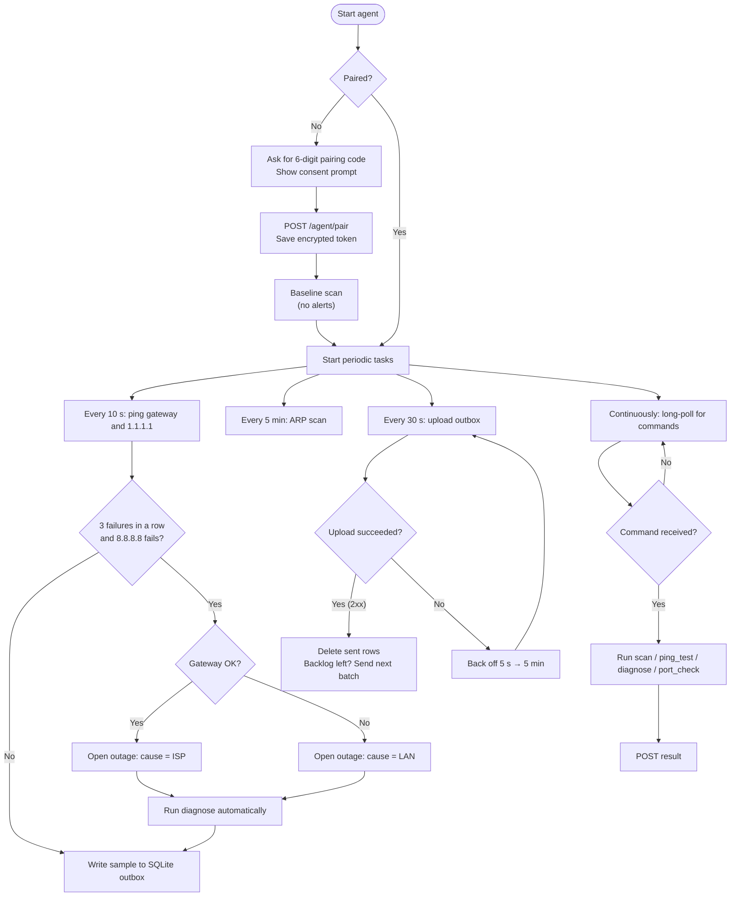
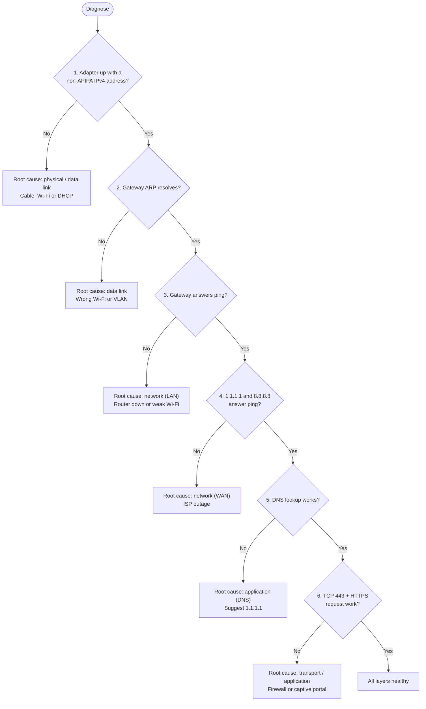
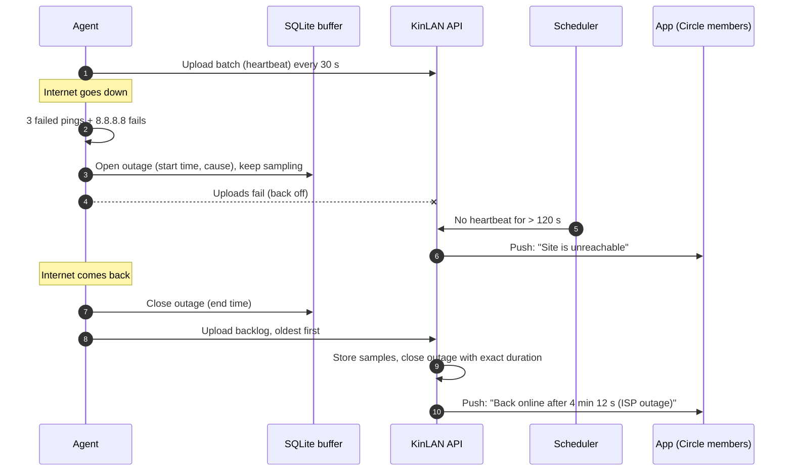
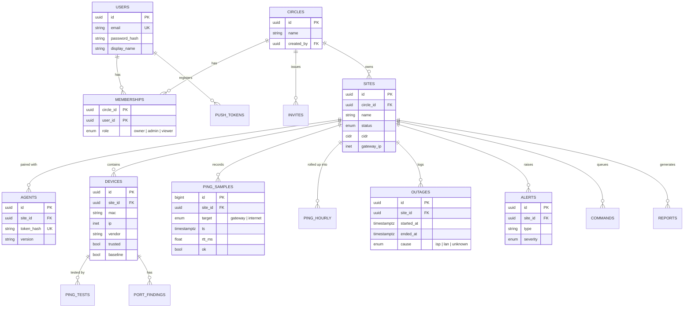

# KinLAN — Chapter 2 diagram drafts

Drafts for Chapter 2 (System Design) of the final report and for the Nov 17 progress report. They're written in Mermaid, so they render in VS Code (Markdown preview with a Mermaid extension) and on GitHub. Redraw the final versions in draw.io for the report, following the same structure.

Source: `docs/KinLAN_Technical_Plan.md`, Sections 1, 3, 4 and 5.

---

## 2.1 Network architecture

**Key point for the defense:** the agent only makes *outbound* HTTPS connections, so it works behind any home router (NAT) with no port forwarding.

---

## 2.2 Use case diagram

Mermaid has no UML use-case shape, so this draft uses a flowchart: rectangles are actors and rounded boxes are use cases. In draw.io, use the UML "Actor" and "Use Case" shapes.

Roles are cumulative: an Admin can do everything a Viewer can, and an Owner everything an Admin can (technical plan, Section 4.2).

---

## 2.3 Flowchart: agent main loop

---

## 2.4 Flowchart: layered diagnose

The diagnosis stops at the first failing step; later steps are reported as *skipped*.

---

## 2.5 Sequence: outage detection and recovery

---

## 2.6 Entity-relationship diagram (core tables)

The full column list is in the technical plan, Section 5.2. `invites`, `pairing_codes`, `refresh_tokens`, `alert_settings`, `ingest_batches`, `commands`, `reports`, `ping_hourly`, `ping_tests`, `port_findings` and `push_tokens` are shown as relationships only, to keep the diagram readable.
